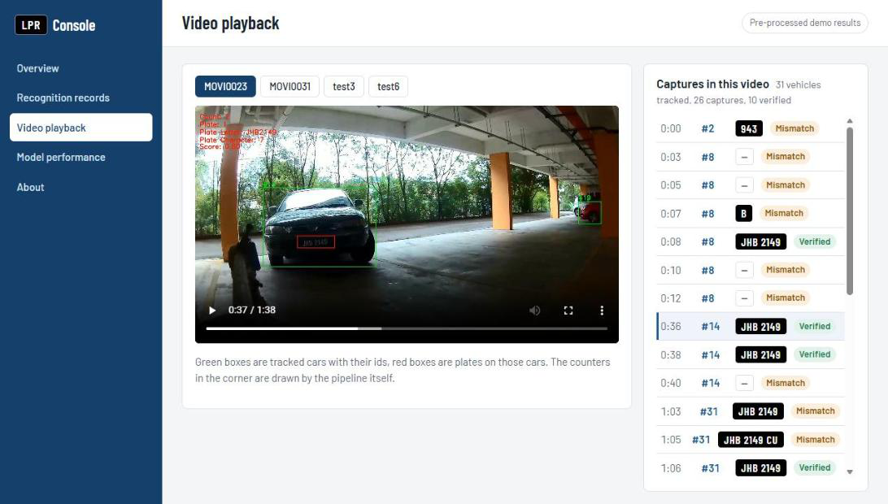

# License Plate Recognition (YOLOv8 + Tesseract)

**Live demo: https://weikang14.github.io/license-plate-recognition/**

A final year project that reads Malaysian license plates from video, plus a dashboard that shows what the pipeline found on 15 recorded test videos. Every number, snapshot and video on the site comes from running the pipeline on that footage.


| Recognition records | Video playback |
|---|---|
|  |  |


## How it works

1. **Find and track vehicles**: YOLOv8n (COCO) finds vehicles in every frame (cars, plus buses and trucks, because a car close to the camera is often labelled truck), and ByteTrack ([supervision](https://github.com/roboflow/supervision)) gives each one an id that follows it from frame to frame and survives gaps of up to 3 seconds, so a car that stays in view is not counted twice.
2. **Find the plate**: a YOLOv8s plate detector trained for this project. A plate only counts when it sits on a tracked car, so a photo of a plate held up to the camera is ignored. Plates with confidence 0.75 or higher are captured, at most once every 1.5 seconds.
3. **Prepare it**: the crop is converted to grayscale and enlarged to 800 pixels wide. The project's original fixed-point perspective correction was removed after testing: its fixed points crop or skew characters on most plates, and without it verified captures on the test videos rose from 10 to 47.
4. **Read it twice**: Tesseract OCR reads the text (page mode 6), and a second YOLOv8 model detects each character at confidence 0.4. If the two readings differ, Tesseract reads the plate once more as a single raw line (page mode 13).
5. **Cross-check**: both readings are put in left-to-right order, Tesseract's words and the character boxes by their horizontal position, and the plate is verified only when they are identical. The original project compared the characters without order, because the character model lists them by confidence, not position, so a reading like 2149JHB could pass for JHB 2149. This works for single-row plates; two-row plates would need the boxes grouped by row first.

## Results

| | |
|---|---|
| Plate detector (YOLOv8s, trained from scratch) | mAP50 0.974, mAP50-95 0.651, precision 0.951, recall 0.957 |
| Test videos processed | 15 |
| Vehicles tracked (counted per video) | 184 |
| Plate captures (plates on a tracked car) | 156, from 44 vehicles |
| Verified by the OCR + YOLO cross-check | 64 (41.0%), from 34 vehicles |
| Average detection confidence | 0.825 |

The plate detector is reliable; reading the plate is the weak step. Tesseract returned no text on 36 of 156 captures, and the character model often misses a character, so the strict cross-check still rejects about three in five captures. The verified captures are two plates, JHB 2149 and VEW 6482, seen in 10 of the 15 videos. Close-up shots where the whole car is not in view are skipped on purpose: without a tracked car there is nothing to prove the plate is on a real vehicle. Removing the fixed perspective correction raised verified captures from 10 (6.7%) to 47 (31.5%) on the same footage; the project report had already noted that it left too little margin around plates filmed at close range. Comparing the readings in left-to-right order, with the character model at confidence 0.4 and a second Tesseract pass as a single line, then raised them to 60 (40.3%) and removed the one capture that had passed out of order (2149JHB). Keeping each vehicle's id through gaps of up to 3 seconds then lowered the vehicle count from 223 to 184, because a car that stays in view is no longer counted twice; the published run has 156 captures, 64 of them verified (41.0%). Every mismatch is listed on the site with both readings side by side.

## Speed

Time per stage on one 1080p frame, measured with `tools/benchmark.py` (also on the site's Model performance page):

| Stage | Runs | Laptop CPU (Core i5-12450H) | Laptop GPU (RTX 4060) |
|---|---|---|---|
| Vehicle detection (YOLOv8n) | every frame | 75.8 ms | 10.6 ms |
| Plate detection (YOLOv8s) | every 7th frame | 120.7 ms | 10.4 ms |
| Character detection (YOLOv8n) | per capture | 58.4 ms | 13.8 ms |
| Tesseract OCR | per capture, twice if psm 13 is needed | 152.1 ms | CPU only |
| **Frames per second** (vehicles + plates) | | **11 fps** | **83 fps** |

The site data was built on the CPU, at about 11 fps, below the cameras' 25-30 fps. On the GPU the detectors run at about 83 fps, and Tesseract, which has no GPU version and runs at most once every 1.5 seconds per capture, becomes the slowest step. CPU: PyTorch 2.3.1 with Ultralytics 8.1.27; GPU: PyTorch 2.7.0 with Ultralytics 8.3.127.

## Next steps

1. **One recognition model instead of two readers.** Replace Tesseract, the character model and the cross-check with a single model that reads the whole plate in one pass. Running two readers on every capture, and Tesseract a second time when they disagree, is the slowest part of reading a plate (see Speed above), and Tesseract cannot run on a GPU.
2. **Two-row plates.** The left-to-right ordering only works for plates written on one line.
3. **Keep vehicle ids through occlusion.** The tracker matches vehicles by position only, so a car that passes close in front of a parked one can take over the parked car's id.

## Who built what

- **weikang14, final year project:** the dataset, training the plate and character detectors, and the recognition pipeline: vehicle, plate, two readers and the cross-check (`code/Final_License_Plate_Detection.ipynb`).
- **Built with [Claude Code](https://claude.com/claude-code), an AI coding assistant, after the project:** this dashboard, moving the notebook's pipeline into `tools/` with tests and the speed benchmark, and the post-project changes described above (vehicle tracking, removing the fixed perspective correction, the ordered cross-check). Earlier commits in this repository show "Claude Code" as the author name for this reason.

## Repository layout

```
code/Final_License_Plate_Detection.ipynb   original FYP notebook
models/                                    plate.pt, plate_letter.pt, yolov8n.pt
tools/lpr_pipeline.py                      the notebook's pipeline as a module
tools/build_site_data.py                   runs the pipeline on test videos, writes web/data/
tools/site_data.py                         metrics and summary for the dashboard
tools/benchmark.py                         times each stage on CPU or GPU, writes web/speed.json
tools/serve.py                             local static server (supports video seeking)
web/                                       the dashboard (plain HTML, CSS, JS and Chart.js)
tests/                                     pytest and node tests
```

## Run the dashboard locally

```
python tools/serve.py
```

Then open http://127.0.0.1:8765. (`python -m http.server` also works, but it can't seek inside videos.)

## Regenerate the site data

Needs Python 3.11 with the packages in `requirements.txt` (`pip install -r requirements.txt`), plus [Tesseract OCR](https://github.com/UB-Mannheim/tesseract) and [ffmpeg](https://ffmpeg.org/). Point `TESSERACT_CMD` and `FFMPEG` at them if they are not on `PATH`. The raw test videos (`videos/`) and the training runs (`training_results/`) are kept locally and are not in this repository; tests that need them are skipped when they are missing.

```
python tools/build_site_data.py --videos path/to/test/videos --out web/data --playback 4
python tools/benchmark.py --device cpu      # or --device 0 for the first CUDA GPU
python -m pytest tests
node --test "tests/web/*.test.mjs"
```
