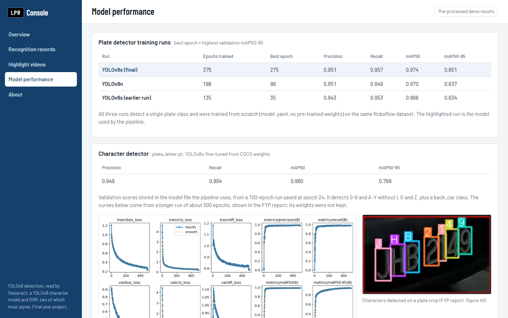

# License Plate Recognition (YOLOv8 + Tesseract)

**Live demo: https://weikang14.github.io/license-plate-recognition/**

A final year project that reads Malaysian license plates from video, plus a dashboard that shows what the pipeline found on 15 recorded test videos. Every number, snapshot and video on the site comes from running the pipeline on that footage.


| Recognition records | Video playback |
|---|---|
|  |  |



## How it works

1. **Find and track vehicles**: YOLOv8n (COCO) finds cars in every frame, and ByteTrack ([supervision](https://github.com/roboflow/supervision)) gives each car an id that follows it from frame to frame.
2. **Find the plate**: a YOLOv8s plate detector trained for this project. A plate only counts when it sits on a tracked car, so a photo of a plate held up to the camera is ignored. Plates with confidence 0.75 or higher are captured, at most once every 1.5 seconds.
3. **Straighten it**: the crop is converted to grayscale, resized and perspective-corrected.
4. **Read it twice**: Tesseract OCR reads the text, and a second YOLOv8 model detects each character.
5. **Cross-check**: a plate is verified only when both readers find the same characters, compared without order, and the OCR text is kept as the result. Known shortcut: the character model returns its characters in a scrambled order (YOLO lists detections by confidence, not position), and during the project no way was found to put them back in reading order, so Tesseract supplies the order. Sorting the character boxes by horizontal position would fix this.

## Results

| | |
|---|---|
| Plate detector (YOLOv8s, trained from scratch) | mAP50 0.974, mAP50-95 0.651, precision 0.951, recall 0.957 |
| Test videos processed | 15 |
| Vehicles tracked (counted per video) | 223 |
| Plate captures (plates on a tracked car) | 149, from 45 vehicles |
| Verified by the OCR + YOLO cross-check | 10 (6.7%), from 5 vehicles |
| Average detection confidence | 0.825 |

The plate detector is reliable; reading the plate is the weak step. Tesseract returned no text on 50 of 149 captures, and the character model frequently misses a character, so the strict cross-check rejects most captures. All 10 verified captures are the same plate, JHB 2149, seen in four videos. Close-up shots where the whole car is not in view are skipped on purpose: without a tracked car there is nothing to prove the plate is on a real vehicle. The project report notes that the fixed perspective correction leaves too little margin around plates filmed at close range, which hurts OCR. Every mismatch is listed on the site with both readings side by side.

## Repository layout

```
code/Final_License_Plate_Detection.ipynb   original FYP notebook
models/                                    plate.pt, plate_letter.pt, yolov8n.pt
tools/lpr_pipeline.py                      the notebook's pipeline as a module
tools/build_site_data.py                   runs the pipeline on test videos, writes web/data/
tools/site_data.py                         metrics and summary for the dashboard
tools/serve.py                             local static server (supports video seeking)
web/                                       the dashboard (plain HTML, CSS, JS and Chart.js)
tests/                                     pytest and node tests
```

## Run the dashboard locally

```
python tools/serve.py
```

Then open http://127.0.0.1:8765. (`python -m http.server` also works, but it can't seek inside videos.)

## Regenerate the site data

Needs Python with `ultralytics`, `supervision`, `opencv-python` and `pytesseract`, plus [Tesseract OCR](https://github.com/UB-Mannheim/tesseract) and [ffmpeg](https://ffmpeg.org/). Point `TESSERACT_CMD` and `FFMPEG` at them if they are not on `PATH`. The raw test videos (`videos/`) and the training runs (`training_results/`) are kept locally and are not in this repository; tests that need them are skipped when they are missing.

```
python tools/build_site_data.py --videos path/to/test/videos --out web/data --playback 4
python -m pytest tests
node --test "tests/web/*.test.mjs"
```
